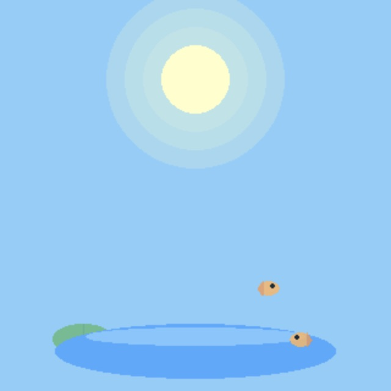
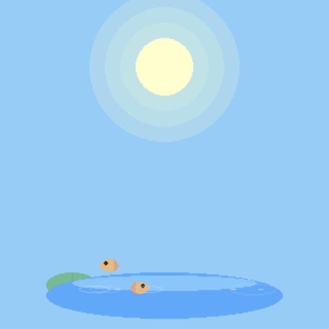
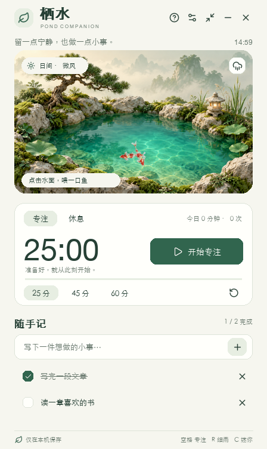
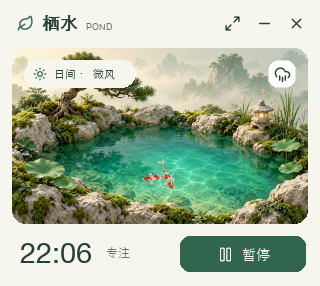
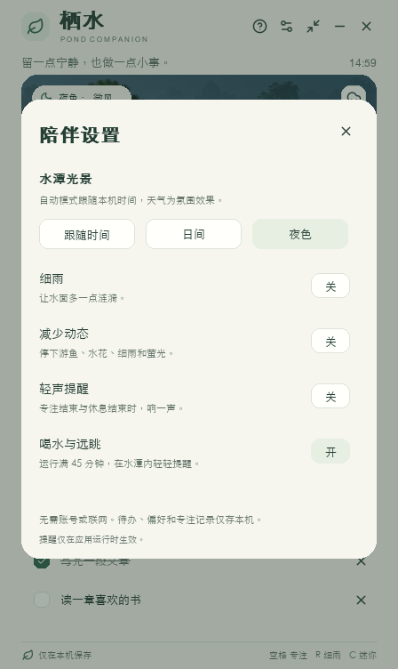
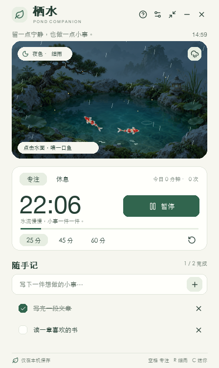

# 栖水：设计复核与验证

日期：2026-10-15。基线：GitHub `main` 的 `fc0c494`，本次从仓库获取并在本机运行。目标是在保留水潭、游鱼与季节光景的基础上，为日常工作增加可用的专注与待办功能。

## 证据来源

步骤 1、2 的 JPEG 是本次使用 Computer Use 捕获并逐张检查的真实 macOS 原生窗口。改版后的原生窗口也进行了启动、英文输入、中文粘贴与字体显示检查；中文粘贴曾暴露平台问题，已修复。

步骤 3–7 的 PNG 由实际应用的 pygame 渲染器在 SDL dummy 显示环境中输出，使用独立临时存档和示例待办。这些是可复现的界面状态，**不是所有步骤均经过原生鼠标操作的证明**。原生桌面自动化连接间歇中断，因此待办提交、计时、保存与设置的详细行为由事件集成测试补充验证。

## 步骤与发现

| 步骤 | 操作与整体状态 | 发现与改进 |
| --- | --- | --- |
| 1 | 原版启动：需改进 | 小窗安静、主题清楚；3 秒后没有可见操作说明，也没有可见关闭、设置或日常任务入口。 |
| 2 | 原版互动：需改进 | 水花与游鱼有反馈；截图内无法发现键盘与右键操作，互动缺少持久价值。 |
| 3 | 改版随手记：通过渲染与事件测试 | 中文显示、任务完成与恢复、完成计数可见。原生检查确认中文粘贴；事件测试验证中文提交与存档恢复，输入快捷键不再混入正文。 |
| 4 | 改版专注：通过渲染与逻辑测试 | 开始/暂停、剩余时间、进度与时长直接可见。大幅时间跳变只完成一次；退出重开暂停；完成后不自动启动休息。 |
| 5 | 改版迷你陪伴：通过渲染与事件测试 | 保留水潭、计时与暂停按钮；展开后任务和运行状态保持。 |
| 6 | 改版设置：通过渲染与事件测试 | 场景、天气、减少动态、声音、提醒均有明确文字。模态窗口限制键盘焦点，不会操作背后的计时器。 |
| 7 | 改版夜色与细雨：通过渲染与事件测试 | 保留阅读对比度，夜色仅作用于庭院；减少动态时鱼、雨、水花与萤光停止。 |

### 1. 原版启动

### 2. 原版互动

### 3. 随手记

### 4. 专注进行中

### 5. 迷你陪伴

### 6. 陪伴设置

### 7. 夜色细雨

## 可访问性与边界

已加入键盘焦点指示、Tab / Shift+Tab / Enter 操作、Page Up / Page Down 浏览待办、持久帮助入口、较大的主要按钮，以及减少动态。输入框编辑时空格不会误触专注，输入法组合文字的回车也不会提前提交。

这些 pygame 控件没有原生屏幕阅读器语义，不能声称完整无障碍支持。截图也无法证明 VoiceOver / NVDA 支持。字体依赖系统字体；Linux 需要可用的中文字体。

本次实机环境为 macOS、Python 3.14 与已安装的 pygame 2.6.1。Windows / Linux 的原生窗口、输入法、音频和剪贴板仍需实机验证。普通浮动窗口没有保证置顶、点击穿透或逐像素透明。应用退出时不运行提醒，提醒也不会发送到系统通知中心。

## 验证

- 22 项 `unittest` 全部通过：专注/休息、计时大幅跳变、日期切换、离线恢复、中文和输入法事件、剪贴板调用、键盘待办浏览、紧凑模式、模态焦点、减少动态、损坏存档备份、原子写入失败与不可读文件保护。
- Ruff 检查与格式检查通过；`git diff --check` 通过。
- 构建 wheel 并安装到独立虚拟环境，从仓库以外的目录执行 `zhuo-chong --frames 3`，确认入口与 PNG 资源可用。
- 添加 Linux / Python 3.9 与 3.13 的 CI，执行样式检查、测试与安装后入口检查。CI 的最终状态以 GitHub 页面为准。

完整安装、操作、数据目录与隐私说明见 [README](../README.md)。插画提示词与图标许可见 [素材说明](../pondpet/assets/README.md)。
